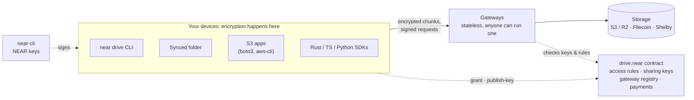

<div align="center">

# NEAR Drive

**Private storage for every NEAR account.**
End-to-end encrypted files at `near://alice.near/path`, shared by account name, synced across your devices.

[](https://github.com/ilblackdragon/near-drive/actions/workflows/ci.yml)
[](#license)


[Install](#install) · [Quick start](#quick-start) · [Sync a folder](#sync-a-folder) · [S3 apps](#use-it-from-s3-apps) · [SDKs](#sdks) · [Docs](#documentation)

</div>

---

## Why NEAR Drive

- 🔐 **End-to-end encrypted.** Files are encrypted on your device. Gateways and storage providers only ever see
  ciphertext.
- 🪪 **Your NEAR account is your login.** No new accounts or passwords: requests are signed with your NEAR keys, which
  stay in near-cli. Your encryption key can be re-derived from your account on any device.
- 🤝 **Share by account name.** `near drive share report.pdf bob.near`. Folder-level rules ("each user reads and
  writes their own folder, the app pays") live onchain.
- 📁 **Dropbox-style sync and files on demand** on Linux, macOS and Windows: a synced folder (selective, with a
  tray icon), or a mounted drive where files download only when opened. Plus a CLI, an S3-compatible endpoint for
  existing tools, and Rust / TypeScript / Python SDKs.
- 🌐 **No single operator.** Gateways are stateless and anyone can run one; storage sits on S3 / R2, Filecoin or
  Shelby behind them, and you never have to pick.
- 🏋️ **Built for big files too.** Parallel, resumable transfers, byte-range reads and direct downloads for model
  weights and datasets.

## How it works



A file is split into chunks, encrypted with a key only you (and whoever you share with) can unwrap, and uploaded
through any gateway. Each chunk is addressed by its hash, so everything you read back is verified. The gateway checks
that the request is signed by a key of the account, and that the account's rules allow it. More in
[DESIGN.md](DESIGN.md).

## Install

You need [Rust](https://rustup.rs) and [near-cli-rs](https://github.com/near/near-cli-rs) (NEAR Drive uses it for
your NEAR keys).

```sh
cargo install near-cli-rs                                                       # if you don't have `near` yet
cargo install --git https://github.com/ilblackdragon/near-drive near-drive-cli    # installs `near-drive`
cargo install --git https://github.com/ilblackdragon/near-drive near-drive-tray   # optional: tray / menu-bar icon
```

Once `near-drive` is on your `PATH`, it also runs as a near-cli subcommand: `near drive ...`.

> **Alpha.** There is no public gateway or mainnet `drive.near` deployment yet. Point the CLI at a gateway with
> `--gateway <url>` (or `NEAR_DRIVE_GATEWAY`), or [run your own](docs/gateway.md).

## Quick start

```sh
near drive login                        # pick your account; near-cli adds a limited NEAR Drive key
near drive keygen --ckd                 # your encryption key, derived from your account (same on every device)

near drive put notes.txt                # -> near://<you>/notes.txt
near drive put report.pdf docs/         # -> near://<you>/docs/report.pdf
near drive ls
near drive get docs/report.pdf
near drive share docs/report.pdf bob.near

near drive                              # no arguments: an interactive menu
```

In a terminal, anything you leave out is asked for, and afterwards the CLI prints the full command so you can script
it. Full reference: [docs/cli.md](docs/cli.md).

## Sync a folder

```sh
near drive sync add ~/NearDrive         # ~/NearDrive <-> near://<you>/Drive/
near drive up                           # keep it in sync in the background
near drive sync status
```

Edits sync both ways (changes elsewhere arrive within seconds), conflicts keep both copies, deletes from other
devices go to a local trash, and edits made offline go up when you're back online. Leave subfolders out with
`sync exclude`. `near-drive-tray` puts the status and your folders in the system tray / menu bar.
Details: [docs/sync.md](docs/sync.md).

Rather not download everything? Mount it instead; files download when opened:

```sh
near drive mount ~/NEAR\ Drive           # Linux (FUSE), macOS (macFUSE / FUSE-T), Windows (Cloud Files, like OneDrive)
```

Details: [docs/mount.md](docs/mount.md).

## Use it from S3 apps

`near drive up` also starts an S3-compatible endpoint on `127.0.0.1:9000` and prints the `AWS_*` settings to export.
Existing code only changes its endpoint, and your data stays end-to-end encrypted:

```python
import boto3
s3 = boto3.client("s3", endpoint_url="http://127.0.0.1:9000")   # keys from the AWS_* exports
s3.upload_file("ckpt.bin", "alice.near", "ckpts/step-100.bin")    # = near://alice.near/ckpts/step-100.bin
```

Supported operations and options: [docs/s3.md](docs/s3.md).

## SDKs

| language | where | |
|---|---|---|
| Rust | [`crates/near-drive-client`](crates/near-drive-client) | streaming, parallel and resumable transfers |
| TypeScript | [`sdk/ts`](sdk/ts) | Node ≥ 20 and browsers |
| Python | [`sdk/python`](sdk/python) | Python ≥ 3.10 |

```rust
use near_drive_client::{near_drive_core::NearUri, Client, PutOptions};

let client = Client::new("https://gateway.example", "alice.near", signing_key, Some(root_key));
let uri = NearUri::parse("near://alice.near/memory/today.json")?;
client.put(&uri, br#"{"hello":"world"}"#, &PutOptions::default()).await?;
let (_head, data) = client.get(&uri).await?;
```

All three SDKs read and write the same format and use the same keys as the CLI.

## Documentation

| | |
|---|---|
| [docs/cli.md](docs/cli.md) | every command, paths, keys and near-cli, sharing and access rules, large files |
| [docs/sync.md](docs/sync.md) | synced folders: behaviour, conflicts, deletes, file names |
| [docs/mount.md](docs/mount.md) | files on demand (`near drive mount`) |
| [docs/s3.md](docs/s3.md) | the S3-compatible endpoint |
| [docs/gateway.md](docs/gateway.md) | running a gateway: storage backends, classes, caches, billing |
| [docs/contract.md](docs/contract.md) | the `drive.near` contract |
| [docs/ckd.md](docs/ckd.md) | deriving encryption keys from your account (MPC CKD) |
| [docs/payments.md](docs/payments.md) | paying for storage with stablecoins / NEAR Intents |
| [docs/backends.md](docs/backends.md), [docs/blob-bridge.md](docs/blob-bridge.md) | storage providers and the bridge protocol |
| [DESIGN.md](DESIGN.md) | architecture, protocol, roadmap and what is verified |
| [docs/development.md](docs/development.md) | building from source, running locally, tests |

## Contributing

Issues and pull requests are welcome. See [docs/development.md](docs/development.md) to build and test locally.

## License

Licensed under either of [Apache License 2.0](LICENSE-APACHE) or [MIT license](LICENSE-MIT), at your option.
